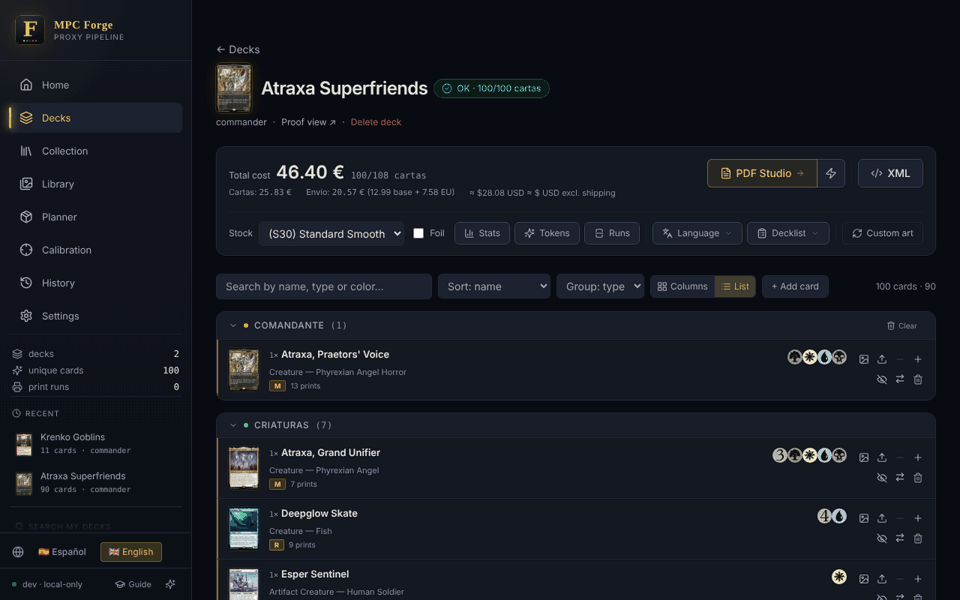
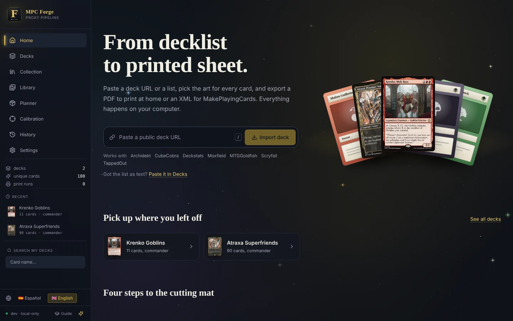
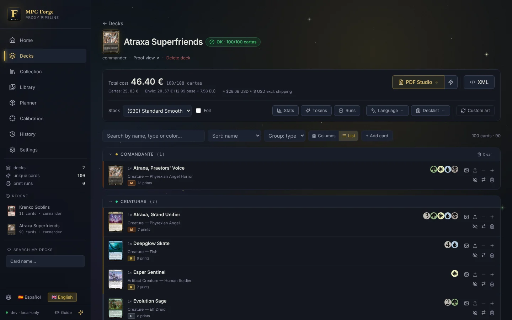
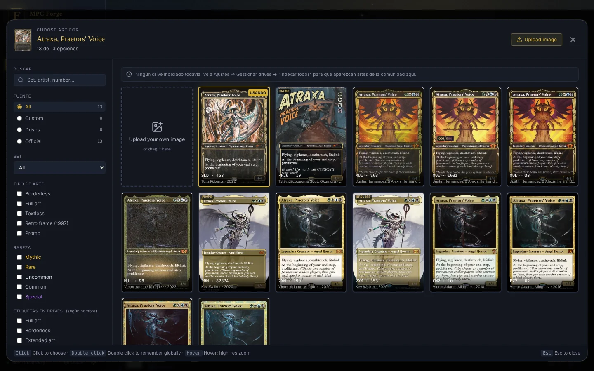
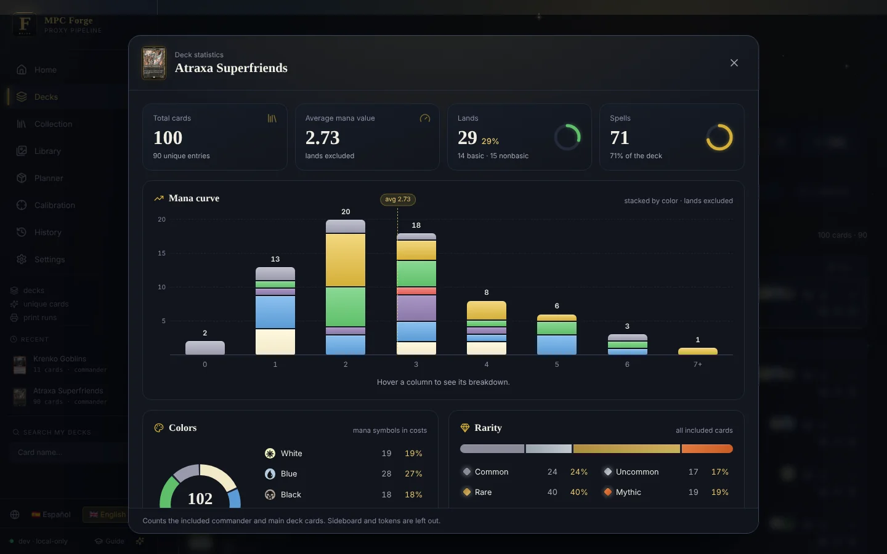
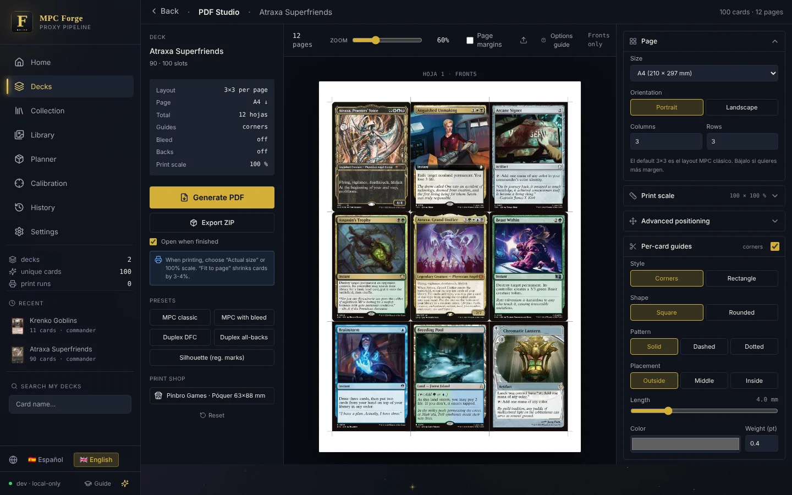
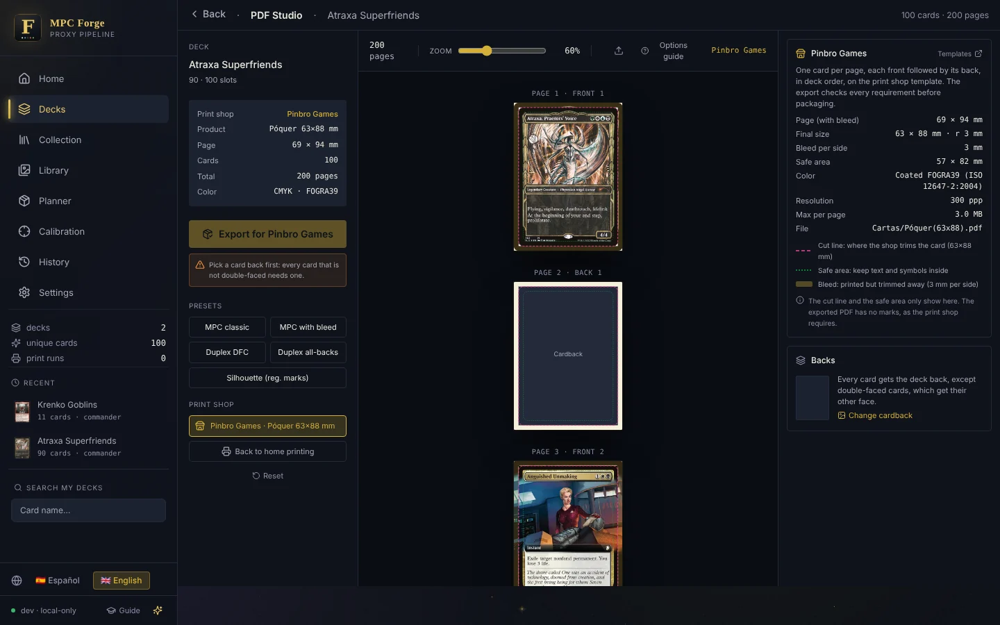
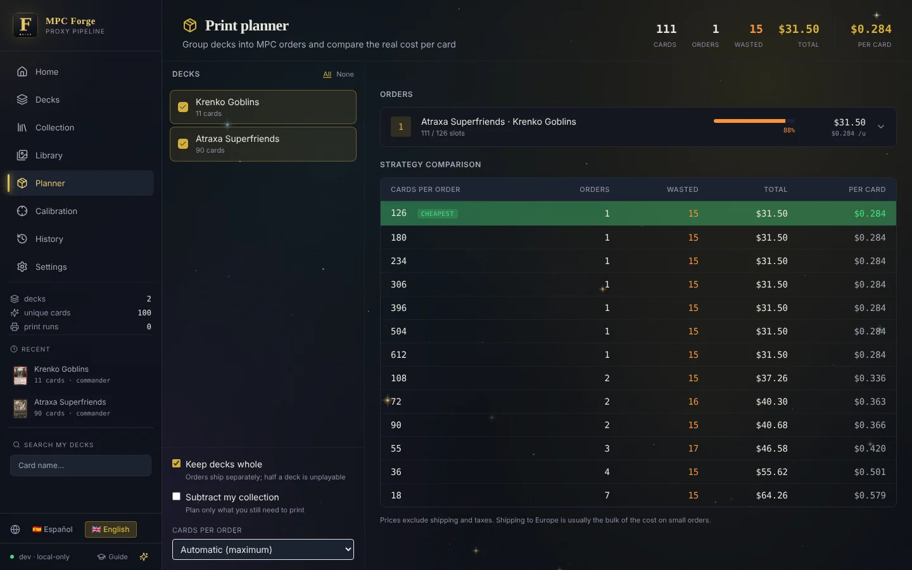
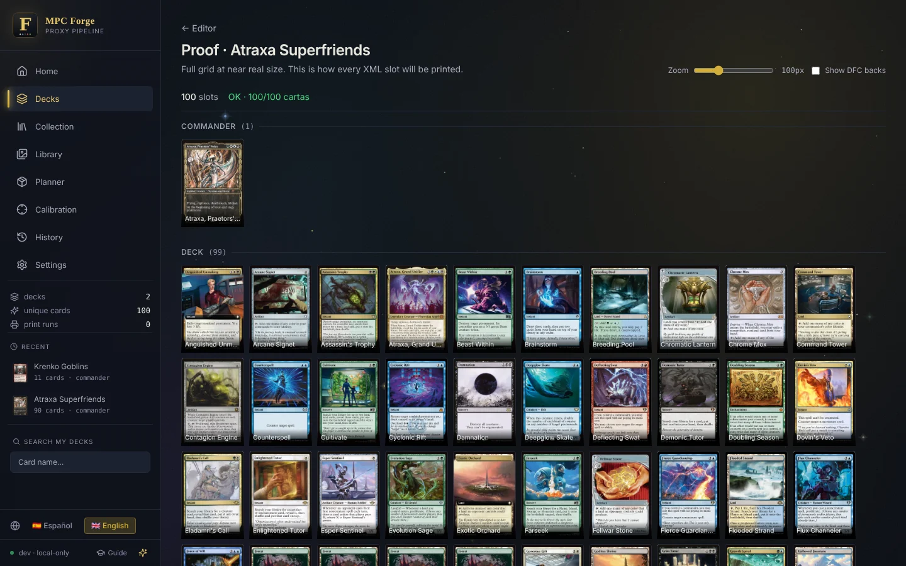

<div align="center">


# MPC Forge

**From decklist to printed sheet — a local-first workshop for Magic: The Gathering proxies.**

Paste a decklist, pick the art for every card, and export a print-ready PDF, a
print-shop package or an MPC Autofill XML — without leaving your computer.

[](https://github.com/AdrianJimenezSantiago/mtg-forge/actions/workflows/ci.yml)
[](https://github.com/AdrianJimenezSantiago/mtg-forge/releases)
[](https://github.com/AdrianJimenezSantiago/mtg-forge/releases/latest)
[](LICENSE)


[**Download**](https://github.com/AdrianJimenezSantiago/mtg-forge/releases/latest) ·
[Features](#features) ·
[Getting started](#getting-started) ·
[Print shops](#sending-a-deck-to-a-print-shop) ·
[Development](docs/DEVELOPMENT.md)

<br>



</div>

---

## Why MPC Forge

```
Moxfield · Archidekt · Deckstats · TappedOut · MTGGoldfish · CubeCobra · Scryfall · plain text
                                        │
                              card resolution (Scryfall)
                                        │
          art picker  ◄──  official printings · community Google Drives · your own images
                                        │
     printable PDF  ·  print shop package  ·  MPC Autofill XML  ·  image ZIP  ·  decklist.txt
```

- 🏠 **Everything lives on your machine.** No account, no server, no telemetry.
  The interface is served by the app itself and works offline once your card
  data and art are cached.
- 🎨 **Every printing, every community scan, your own art.** One picker for all of it.
- 🖨️ **Prints that come out right.** Cut guides, bleed, duplex calibration and a
  CMYK package for professional print shops.
- 🌍 **English and Spanish**, with a guided tour on every screen.

## Screenshots

<table>
  <tr>
    <td width="50%"><br><sub><b>Home</b> — import a deck from a URL in one field.</sub></td>
    <td width="50%"><br><sub><b>Deck editor</b> — cost per order, validation and every card at a glance.</sub></td>
  </tr>
  <tr>
    <td><br><sub><b>Art picker</b> — official printings, community drives and your uploads, with filters.</sub></td>
    <td><br><sub><b>Statistics</b> — animated mana curve, colours, rarity and card functions.</sub></td>
  </tr>
  <tr>
    <td><br><sub><b>PDF Studio</b> — margins, bleed, cut guides and duplex for home printing.</sub></td>
    <td><br><sub><b>Print shop mode</b> — one card per page, bleed, safe area, FOGRA39.</sub></td>
  </tr>
  <tr>
    <td><br><sub><b>Print planner</b> — group decks into MakePlayingCards orders and compare prices.</sub></td>
    <td><br><sub><b>Proof</b> — the whole deck at near real size before you order.</sub></td>
  </tr>
</table>

## Features

| | |
| --- | --- |
| 📥 **Import from anywhere** | Paste a URL from any supported deck site, or a plain-text list in the usual formats (`1 Sol Ring`, `1 Sol Ring (C21) 263`, section headers for commander, sideboard and maybeboard). Cards that cannot be resolved come back with the original line and "did you mean" suggestions. |
| 🖼️ **Art picker over community drives** | Indexes the public MPC Autofill Google Drives with SQLite FTS5 and makes them searchable instantly, with filters for full art, borderless, extended, showcase, retro frame, artist and set. Perceptual hashing removes duplicates across drives. |
| 📚 **Art library** | Browse the whole index without starting from a card: an artist's work, every full-art print of a set, and so on. |
| 📄 **PDF Studio** | Fine control over home printing: margins, bleed, per-card and per-page cut guides, square or rounded corners, duplex with drift compensation, and card backs for DFCs or the whole deck. |
| 🏭 **Print shop export** | A CMYK, one-card-per-page package ready to send to a professional print shop. [More below](#sending-a-deck-to-a-print-shop). |
| 🎯 **Duplex and scale calibration** | A test sheet turns "the back comes out misaligned" into two offsets, and a ruler sheet undoes the printer's "fit to page" scaling. |
| 🧮 **Print planner** | Combine several decks into MakePlayingCards orders and see which bracket each order lands in before you buy. |
| 🗃️ **Collection** | Track the cards you actually own, by set, and cross-reference them with your decks to print only what is missing. |
| 📊 **Deck statistics** | Animated mana curve, colours, rarity, types, keywords and — with offline card data — each card's function (ramp, draw, removal…). |
| ⏪ **History and undo** | Every change to a deck is recorded on a timeline and can be reverted individually. Snapshots let you compare and restore whole versions. |
| 💾 **Storage breakdown** | *Settings → Storage* shows what the app uses on disk, the free space left, and one-click cleanup of everything that can be regenerated. Your database, custom art and card backs are never offered for deletion. |
| ✈️ **Offline card data** | Import Scryfall's bulk data so resolution, autocomplete, printings and recommendations are answered locally. See [Working with Scryfall](#working-with-scryfall). |

## Installation

### Windows executable (recommended)

1. Download the `.zip` from the [latest release](https://github.com/AdrianJimenezSantiago/mtg-forge/releases/latest).
2. Extract it anywhere.
3. Run `MPC-Forge.exe`.

No installer or administrator rights are needed. The app opens in your default
browser at `http://127.0.0.1:8765`. Set the `MPC_FORGE_PORT` environment
variable to use a different port.

### From source

Requires Python 3.11 or later.

```bash
git clone https://github.com/AdrianJimenezSantiago/mtg-forge.git
cd mtg-forge
python -m venv .venv
source .venv/bin/activate          # Windows: .venv\Scripts\activate
pip install -r requirements.txt
python -m mpc_forge
```

| Option         | Description                                                    |
| -------------- | -------------------------------------------------------------- |
| `--port N`     | Listen on port `N` (default `8765`).                           |
| `--host H`     | Bind address (default `127.0.0.1`). The app has no password: any other address exposes it to the network. |
| `--no-browser` | Do not open a browser tab on startup.                          |
| `--window`     | Open in a native window instead (`pip install pywebview`).     |
| `--no-update`  | Skip the update check on startup.                              |

Node.js is **not** required: the compiled frontend assets are committed in
`static/vendor/`.

### Automatic updates

Every time it starts, the app checks for a newer version if there is an internet
connection, and installs it before opening:

- **Executable.** It asks GitHub for the [latest release](https://github.com/AdrianJimenezSantiago/mtg-forge/releases/latest)
  (a new one is published after every green push to `main`). If it is newer, it
  downloads the package for your platform, verifies its checksum, replaces the
  program files and opens again with the new version. The `user-settings/`
  folder is kept as is.
- **From source.** If your clone is on `main` with no local changes, it fetches
  `origin/main`, fast-forwards, reinstalls the dependencies when
  `requirements.txt` changed, and restarts. Other branches, local changes or a
  `main` that has diverged are never touched.

Offline, or if anything goes wrong, the app simply starts with the version you
have. Turn it off in *Settings → General → Actualizar al arrancar* (update on
startup), with `--no-update`, or with `MPC_FORGE_NO_UPDATE=1`. Versions before
this feature have to be updated by hand once.

## Getting started

1. **Import a deck** from the home screen, by URL or by pasting a list.
2. **Add art sources** (optional, recommended). *Settings → Art sources* ships
   with the public MPC Autofill drives preconfigured; press *Index* to make them
   searchable. A [Google Drive API key](https://console.cloud.google.com/apis/credentials)
   makes indexing much faster and more reliable; without one the app falls back
   to scraping.
3. **Choose the art.** In the deck editor, click any card to open the picker
   with every official printing plus everything your drives have for it.
4. **Export.**
   - *Generate XML* — open it with the
     [MPC Autofill desktop client](https://github.com/chilli-axe/mpc-autofill/releases)
     to order from MakePlayingCards.
   - *PDF Studio* — a PDF for your own printer or a print shop, or *Export ZIP*
     for one image per card.
   - *PDF Studio → Print shop* — a package ready to send to a professional
     print shop (see [below](#sending-a-deck-to-a-print-shop)).

> [!TIP]
> Every download (PDFs, ZIPs, XML, decklists, calibration sheets, the log)
> opens the system *Save as* dialog in Chrome and Edge, so you choose the
> folder and the name. Firefox and Safari have no such API and save to their
> download folder as usual. A copy of each export also stays in the app's
> `exports/` folder.

### Sending a deck to a print shop

*PDF Studio → Print shop* switches the studio from home sheets to the template
of a print shop. The first one supported is
[Pinbro Games](https://www.pinbrogames.com/plantillas/), poker size 63×88 mm,
built from its `MOD20_63x88` template and its file preparation guide:

<details>
<summary><b>What the export takes care of</b></summary>

| Requirement                | What the export does                                              |
| -------------------------- | ----------------------------------------------------------------- |
| One card per page          | 69×94 mm pages: the 63×88 mm card plus 3 mm of bleed on each side  |
| Front followed by its back | Deck order, every copy repeated; DFCs get their other face, every other card the deck's card back |
| Bleed covering the page    | Kept from MPC images that already have it; generated for the rest by extending a plain border with its colour or mirroring borderless art. Transparent corners are filled |
| Safe area                  | 57×82 mm; the preview shows it next to the dashed cut line          |
| CMYK Coated FOGRA39, 300 ppi | Every image is separated with the bundled `Coated_Fogra39L_VIGC_300.icc` profile (relative colorimetric, black point compensation, 300 % total ink) and resampled to 815×1110 px |
| No marks, fonts embedded   | Pages hold a single image: no cut marks, no text, no fonts         |
| At most 3 MB per page      | JPEG quality is lowered only if a page would not fit; checked again on the finished file |
| File and folder names      | `Cartas/Póquer(63x88).pdf` inside one ZIP                           |

</details>

The PDF also carries a `TrimBox`/`BleedBox` on every page and a FOGRA39
`OutputIntent`, so prepress software reads the cut size and the colour
condition without guessing. The export refuses decks with cards that have no
image or no back, and lists anything worth a second look (low resolution,
rotated horizontal cards). When it is done, the studio offers the ZIP, the PDF
for review and a ready-made message; upload the ZIP to WeTransfer and send it to
the address shown (the shop does not accept attachments by email).

### Guided tour

The first time you open the app a short welcome tour walks through the sidebar,
and each screen (deck editor, PDF Studio, collection, planner, settings…) shows
its own mini guide the first time you visit it. Use the arrow keys to move and
<kbd>Esc</kbd> to close. Replay them at any time from **Guide** at the bottom of
the sidebar (this screen or the full tutorial) or from *Settings → General*,
where you can also turn the automatic guides off. What you have already seen is
stored in the database, so it survives restarts of the desktop window.

### Custom art

The easiest way is from the app itself: open a card's art picker and press
**Upload image** (or the *Upload your own image* tile), drag an image onto the
card in the deck list or onto its slot in *PDF Studio*, or paste one with
<kbd>Ctrl</kbd>+<kbd>V</kbd> while the picker is open. Before saving you get a
card-shaped preview next to the current art, and the image is checked:

- PNG, JPG or WEBP, up to 30 MB and at least 200 px per side; anything else is
  rejected, as are corrupt or animated files.
- Resolution: a warning below ~240 dpi at card size (745×1040 px is 300 dpi).
- Proportions: images that are not 63×88 (MPC images with bleed are fine) can be
  cropped to the centre, fitted with black borders, or kept stretched.
- Photos are rotated according to their EXIF orientation; uploading the same
  image twice for a card reuses the existing copy.

Uploads are stored under `custom_art/_uploaded/`, assigned to the card straight
away and offered for that card in every deck. Card backs can be uploaded the
same way from *PDF Studio → Card back*.

You can still drop images into the `custom_art/` folder yourself and press
*Rescan*; they appear in the picker next to the official printings. The file
name decides the match:

| File name                     | Matches                                   |
| ----------------------------- | ----------------------------------------- |
| `Sol Ring.png`                | Sol Ring, front face                      |
| `Sol Ring - Anime.png`        | Sol Ring, "Anime" variant                 |
| `Sol Ring (Retro Frame).png`  | Sol Ring, "Retro Frame" variant           |
| `Delver of Secrets [BACK].png`| Delver of Secrets, back face              |
| `Opt [DMU 100].png`           | That exact Scryfall printing              |

## Your data

The app is **portable by default**: if it can write next to the executable (or
the project root when running from source) it uses a `user-settings/` folder
there. Otherwise — for example when installed under `Program Files` — it falls
back to the operating system's per-user data directory.

```
user-settings/
├── mpc_forge.sqlite3   decks, history, collection, drive index
├── art/                images downloaded from Scryfall (deduplicated by SHA-256)
├── thumbs/             generated WebP thumbnails (safe to delete)
├── custom_art/         your own images
├── cardbacks/          custom card backs
├── exports/            generated XML, PDF and ZIP files
├── backups/            backups, including automatic pre-migration ones
└── logs/               log of the current session
```

Every location except the database can be changed in *Settings → Paths*.

> **Updating never deletes your data.** Schema migrations are incremental, and
> an automatic backup is written to `backups/` before any of them runs.
>
> Backups leave out what can be downloaded again: the Scryfall catalog (except
> the printings your decks and collection use) and the `art/` cache. After
> restoring one, import the Scryfall data again from *Settings*. The 5 most
> recent automatic and manual backups are kept.

## Working with Scryfall

Card data comes from the [Scryfall API](https://scryfall.com/docs/api). The
client follows Scryfall's [published rate limits](https://scryfall.com/docs/api/rate-limits)
so that importing and opening many decks in a row never gets the app blocked:

- **Per-endpoint limits.** Search, named lookup and collection requests are
  spaced at 2 per second; every other endpoint at 10 per second, with a safety
  margin on both.
- **Global back-off.** If Scryfall ever answers `429 Too Many Requests`, *all*
  requests pause for the 30-second block instead of retrying through it.
- **Fewer requests in the first place.** Cards already in the local cache are
  resolved without the network, identical in-flight requests are shared, and
  alternate printings for a whole deck are fetched with a handful of combined
  searches rather than one search per card.
- **Offline mode.** *Settings → Offline mode* imports Scryfall's
  [bulk data](https://scryfall.com/docs/api/bulk-data) (`default_cards`: an
  ~80 MB `jsonl.gz` download, about 115,000 printings and ~210 MB in the
  database; around a minute and a half). With it, resolving decklist names,
  adding a card, autocomplete, alternate printings, artist and style
  recommendations, "did you mean" suggestions and a set's card list are
  answered from the local database, and only what is not there goes to the
  API. Prices, legalities and the card functions shown in the deck statistics
  (from Scryfall's community tags) come with it. Once imported it is refreshed
  in the background at startup when it is more than a week old and Scryfall has
  published a newer file (*Keep card data up to date*, on by default). The API
  is also available: `POST /api/bulk/sync`, `GET /api/bulk/progress`,
  `POST /api/bulk/cancel`.
- **Card migrations.** Once a day the app reads Scryfall's
  [card migrations](https://scryfall.com/docs/api/migrations) and points decks,
  art preferences and the collection at the new id when Scryfall merges a card
  into another.

Card images are shown as WebP (`grid`, `display`, `thumb`): Scryfall retires
the old `small`, `large`, `border_crop` and `art_crop` JPEGs on January 1st
2027, and links stored by older versions are rewritten on upgrade. Printing
downloads the full `png` once and caches it on disk; a card is downloaded again
only if Scryfall rescans it. Set icons are downloaded once and served by the app
instead of being hotlinked.

## Contributing

Bug reports and pull requests are welcome. The [development guide](docs/DEVELOPMENT.md)
covers the project layout, the test suite, frontend assets, database
migrations, building the executable and how releases are cut.

## Credits and disclaimer

- Card data and official images: [Scryfall](https://scryfall.com).
- XML format and community drives: [MPC Autofill](https://github.com/chilli-axe/mpc-autofill).
- Mana symbols: [mana-font](https://github.com/andrewgioia/mana).

This tool is intended for personal use: making playtest copies of cards you do
not own, to play at home. It is not affiliated with Wizards of the Coast,
Scryfall or MakePlayingCards. Magic: The Gathering is a trademark of Wizards of
the Coast. Do not sell proxies.

Released under the [MIT License](LICENSE).
